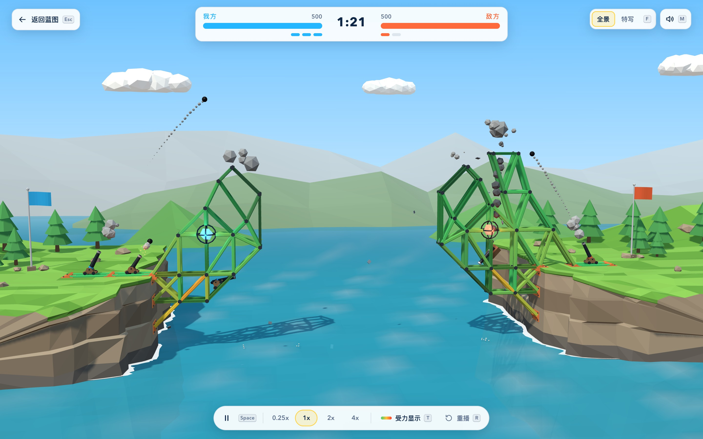
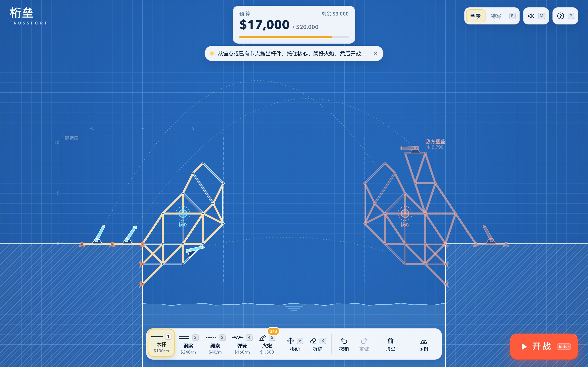
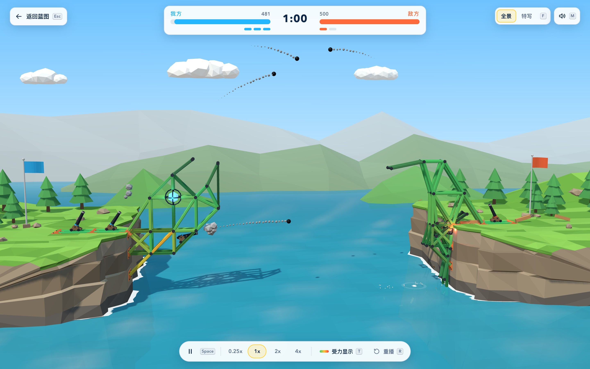
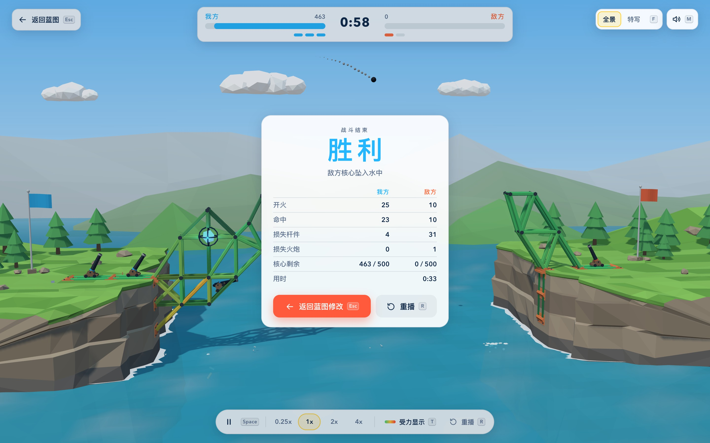
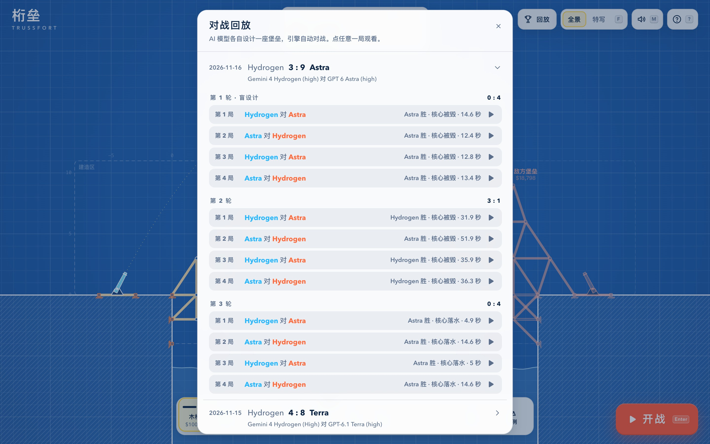

# 桁垒 TRUSSFORT

造桥式堡垒攻防小游戏：在蓝图上用木杆、钢梁、绳索、弹簧搭桁架堡垒护住核心、架好火炮，点「开战」后切到 3D 实景，和对面的堡垒自动对轰，直到一方核心被毁、落水或坠地。随时可以退回蓝图修补再打。

场地是可以换的地图：自带海峡、旷野、山梁三张，也可以自己画。对手可以是地图自带的守军、自己这座堡垒的镜像、同一台电脑上的第二位玩家，或者从文件导入的堡垒（比如 AI 设计的）。人和 AI 用同一套堡垒文件和地图文件。



| 蓝图：预算内搭桁架、架火炮、看弹道 | 连锁坍塌：受伤的杆件被压断，炮塔歪倒落水 |
|---|---|
|  |  |

| 战斗结算 | 对战回放：AI 模型设计的堡垒互相对战，逐局可看 |
|---|---|
|  |  |

## 运行

**在线试玩：<https://cyoung-van.github.io/trussfort/>**（需要支持 WebGL 的桌面浏览器）

也可以看 AI 模型设计的堡垒互相对战：打开[对战回放](https://cyoung-van.github.io/trussfort/?replay)选任意一局，或者直接看 [Gemini 4 Hydrogen 对 GPT-6 Astra 的第 2 轮第 1 局](https://cyoung-van.github.io/trussfort/?replay=2026-11-16-hydrogen-vs-astra&round=2&game=1)。

本地运行：下载或克隆本仓库后，直接双击 `index.html`（不需要服务器，也不需要联网，也不用先构建：打包好的 `dist/game.js` 已经在仓库里）。

## 操作

**蓝图界面**

| 操作 | 作用 |
|---|---|
| 从锚点或已有节点拖出 | 搭一根杆件（自动吸附到 1 米网格） |
| 单击节点 | 进入连续搭建，再点一下就放一根，右键或 Esc 结束 |
| 1 / 2 / 3 / 4 | 木杆 / 钢梁 / 绳索 / 弹簧 |
| 用另一种材料点已有杆件 | 换材料，差价实时结算 |
| 5 或 C，再点一根杆件 | 架火炮（只能架在木杆或钢梁上，最多 3 门；炮座两端不能是锚点，也不能贴地） |
| 拖动炮管 | 调射角，虚线是预览弹道（按住 Shift 微调） |
| V | 移动节点；核心也用它拖，可以放到虚线标出的核心范围里的任意位置 |
| X 或右键 | 拆除，全额退款 |
| Ctrl/Cmd + Z，Shift 再加 Z | 撤销 / 重做 |
| Ctrl/Cmd + S | 把我方堡垒导出成 `fort.json` |
| 把 JSON 文件拖进窗口 | 拖到左半边载入为我方，右半边载入为对手 |
| Tab | 对手是「玩家 2」时，换另一位来搭 |
| 滚轮；空格或中键拖动 | 缩放；平移 |
| F | 全景 / 我方特写 |
| Enter | 开战（超预算时不能开战） |

右上角的「回放」打开对战回放列表：点任意一局观看，不会动你自己的蓝图。回放里按 N 看下一局，Esc 回到列表。回放要读取比赛记录文件，所以只在在线版或通过本地服务器打开时可用。

「示例」按钮在这张地图的示例堡垒之间轮换：起手堡垒（会输）、守军的堡垒，海峡还有一座参考堡垒（预算内能打赢守军的一种搭法）。自定义地图没有示例。

**地图和对手**（左上角字标下面的两个按钮）

| 操作 | 作用 |
|---|---|
| 「地图」 | 换地图。每张地图各存各的堡垒。卡片右上角的小按钮：复制一份来改、导出成文件；自定义地图还可以编辑、删除。面板底部可以新建地图、导入地图文件 |
| 「对手」 | 选右边坐谁：守军（地图自带）、镜像（自己这座堡垒的复制品）、玩家 2（两个人轮流搭）、导入的堡垒。面板底部可以导出、导入正在搭的这座堡垒 |
| 「正在搭」 | 对手是玩家 2 时出现，点名字换人。可以在「对手」面板里勾上「搭建时遮住对方的堡垒」，两个人互相不看 |

**地图编辑器**（「地图」面板里新建、复制或编辑时进入）

| 操作 | 作用 |
|---|---|
| 「地形」工具 | 拖动地表上的点；双击地表加一个点；右键点一个点删掉它。两个点上下对齐就是一道崖壁。有水时可以直接拖水面 |
| 「锚点」工具 | 点地表上的网格点放一个锚点，再点一下拿掉 |
| 「范围」工具 | 拖动建造范围和核心范围的四条边；拖动核心改它的默认位置 |
| 左侧面板 | 名称、场地宽度、有没有水和水面高度、预算、火炮上限。底部会说明现在能不能保存，不能的话是哪里不对 |

只画左半场，右半场自动镜像，所以画出来的地图两边条件一样。自定义地图和上面的堡垒都存在浏览器里。

**实景**

| 操作 | 作用 |
|---|---|
| Esc | 返回蓝图（上一战断掉的杆件会按顺序标出，1 号是最先断的） |
| 空格 | 暂停 |
| [ 和 ] | 调速：0.25× / 1× / 2× / 4× |
| T | 开关受力显示（绿 → 黄 → 红，到红就断） |
| R | 重播（同一张蓝图的结果每次相同） |
| 滚轮、拖动 | 缩放、平移 |

## 规则要点

- 核心必须靠结构托在半空：耐久归零、落水或碰到地面都判负。它的位置不固定，可以放在地图给出的核心范围里的任意位置。
- 所有杆件都能挡炮弹，外层杆件就是护甲。一发炮弹有 110 点直击伤害：一层木杆（耐久 100）会被打穿，炮弹带着剩下的伤害继续飞；钢梁（耐久 300）能把它拦下，大约扛三发。
- 溅射伤害会被杆件挡住，所以顶盖和外墙能护住后面的东西。
- 绳索只受拉；弹簧软，可以给炮座缓冲后坐力，但会晃。
- 桁架是铰接的：没有三角形支撑的方框是机构，会折叠。
- 火炮有自重和后坐力，而且必须架在你自己搭的结构上（炮座不能接锚点、不能贴地）。炮座歪了炮弹就打偏；架在木头高塔顶上的炮，第一发就可能把塔震塌。
- 每根杆件除了按长度计价，还有 20 的装配费；把一根直杆切成几段不会更便宜，也不会更耐打。
- 被打伤的杆件承载力下降，可能被自己扛着的力压断，引发连锁坍塌。
- 交火限时 120 秒，到时按核心剩余耐久判定，相差 10 点以内算平局。

以上是当前的规则版本 v2。规则有版本号，旧比赛按它当时的版本回放，见 [AI.md](AI.md) 的「规则版本」。

## AI 对战

堡垒可以写成一份 JSON，由引擎自动对战并给出逐杆、逐炮的反馈，适合让两个 AI 各出一座堡垒来比。格式、规则和接口见 [AI.md](AI.md)。

```bash
node tools/duel.mjs forts/reference.json forts/enemy.json
```

换一张地图打，或者用自己画的地图文件：

```bash
node tools/duel.mjs forts/ridge-starter.json forts/ridge-garrison.json --map ridge
```

## 开发

需要 Node 18 以上。

```bash
npm install        # 安装 three 和 esbuild
npm run build      # 打包 src/ → dist/game.js
npm test           # 物理、规则、地图和平衡的无头测试
npm run battle     # 在终端里跑一场对战并打印时间线
```

改完源码要重新 `npm run build`，或者用 `npm run watch` 自动重打包。

| 位置 | 内容 |
|---|---|
| `src/config.js` | 可调数值：材料强度与造价、火炮、炮弹、物理 |
| `src/map.js` | 地图：数据格式、三张内置地图、地形查询和合法性检查，不依赖浏览器 |
| `src/sim/` | 物理模拟和蓝图数据模型，不依赖浏览器 |
| `src/sim/forts.js`、`forts-maps.js` | 各张地图的预设堡垒：守军、起手堡垒、参考堡垒 |
| `src/rules.js` | 规则版本：哪些规则开关属于哪个版本 |
| `src/editor/` | 蓝图编辑器和地图编辑器（2D 画布） |
| `src/render/` | 3D 场景、结构、特效（three.js） |
| `src/audio/` | 音效（Web Audio 实时合成，没有音频文件） |
| `src/ui/` | 界面 |
| `src/theme.js` | 全部配色 |
| `src/ai/api.js` | AI 对战接口：载入、检查、对战、主客场 |
| `tools/duel.mjs` | AI 对战命令行 |
| `tools/serve.mjs` | 本地静态服务器（按网址载入堡垒观战时用） |
| `forts/` | 示例堡垒的 JSON（海峡三座，旷野和山梁各两座） |
| `arena/referee.mjs` | 模型对抗赛的裁判脚本（调用 agy 和 codex，按轮次对战、反馈、计分） |
| `arena/日期-选手/` | 每场比赛的记录：提示词、回答、每轮堡垒、比分 |
| `arena/index.mjs` | 把各场比赛汇总成 `arena/index.json`，网页里的回放列表读的就是它 |

## 许可证

[MIT](LICENSE)。打包文件 `dist/game.js` 里包含 three.js（同为 MIT 许可）。
